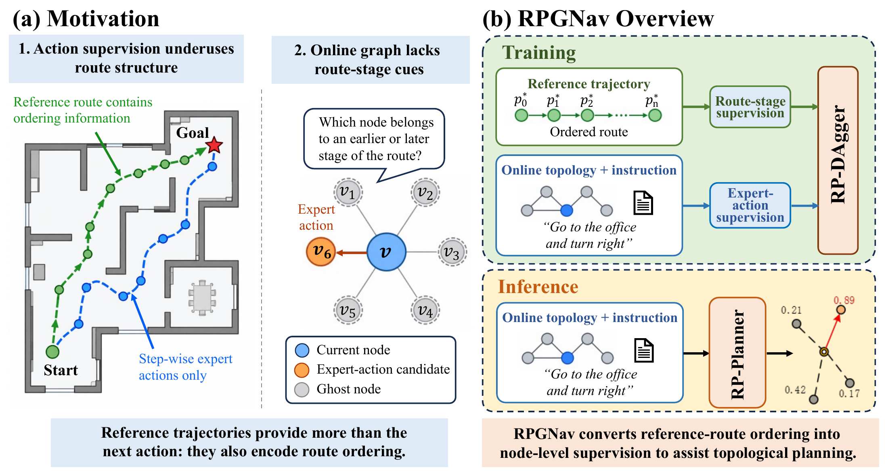
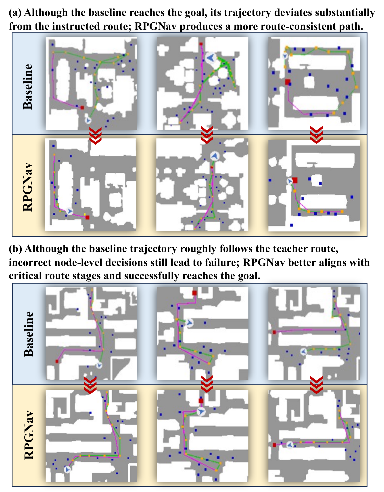
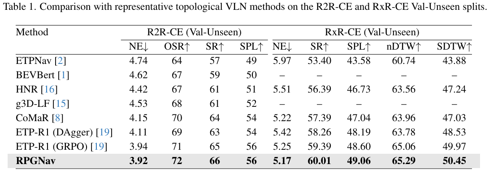
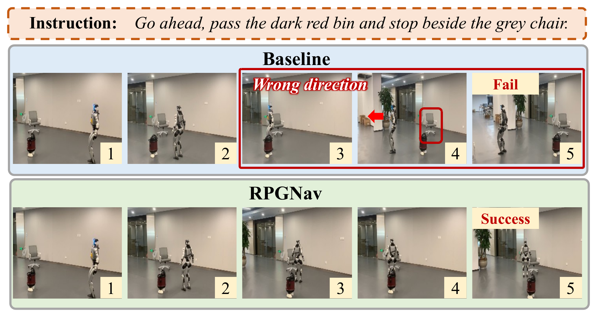

# RPGNav

Online topological Vision-Language Navigation (VLN) enables long-horizon planning through structured spatial memory, yet its training largely relies on step-wise expert-action supervision. While effective for learning navigation decisions, such supervision underutilizes the rich sequential structure embedded in reference trajectories, which provides valuable cues about the relative stages of different locations along a route. To better exploit this information, we propose **RPGNav**, a reference-route progress-guided framework that enriches online topological planning with node-level route-stage supervision. Specifically, **RP-DAgger** transfers reference-route ordering into auxiliary labels for nodes discovered during online exploration, complementing conventional expert-action imitation. Building upon this supervision, **RP-Planner** learns instruction-conditioned representations shared by route-stage prediction and residual action scoring, enabling the planner to leverage route-ordering information for more informed waypoint selection. Extensive experiments on R2R-CE and RxR-CE demonstrate consistent improvements in navigation performance. Furthermore, real-world deployment on a humanoid robot demonstrates RPGNav's ability to follow sequential landmark instructions and successfully reach the destination where the baseline fails.

<p align="center">
  
</p>

## Repository layout

```text
RPGNav/
├── README.md
├── assets/          # Overview, simulation, results and deployment figures
├── simulation/      # Only files changed or added relative to ETP-R1
└── deployment/      # Robot client and standalone GPU inference server
    ├── robot/
    └── server/
        ├── runtime/
        ├── vendor/  # Required inference code, tokenizer and third-party notices
        └── weights/ # Checkpoint configuration and checksums
```

`simulation/` contains the code and configuration to merge into ETP-R1. `deployment/` contains the robot client and GPU inference server.

## Installation and data preparation

Follow the instructions in the [ETP-R1 repository](https://github.com/Cepillar/ETP-R1.git) to set up the environment, datasets and pretrained assets, then apply this project's source overlay as described below. RPGNav uses the same pretrained weights as ETP-R1 to initialize the navigation model.

## Apply the source overlay

Copy all contents of `simulation/` into the ETP-R1 root, merging `habitat_extensions/`, `run_r2r/`, and `vlnce_baselines/` into the same-named baseline folders and overwriting matching files. Keep baseline files that are absent from this lightweight overlay; do not delete the destination folders first.

Use a separate ETP-R1 working copy for each project. From this repository's root, with `ETP-R1/` alongside it:

```bash
cp -a ../ETP-R1 ../ETP-R1-RPGNav
cp -a simulation/. ../ETP-R1-RPGNav/
cd ../ETP-R1-RPGNav
conda activate etpr1
```

## Training and evaluation

Simulation training uses **two NVIDIA GeForce RTX 4090 GPUs**. Run commands from the overlaid ETP-R1 working directory. The training launcher starts two distributed processes, one per GPU, with eight environments per GPU (16 in total). Evaluation uses one GPU and one environment.

Before training, edit `run_r2r/iter_train.yaml`:

- To start from baseline pretrained assets, set `IL.load_from_ckpt: False`. To continue from an online checkpoint, set it to `True` and set `IL.ckpt_to_load` to your local file.
- `PRETRAIN_CKPT` in the launcher selects the ETP-R1 pretrained checkpoint and overrides `MODEL.pretrained_path`; its default is `pretrained/r2r_rxr_ce/mlm.sap_habitat_depth/store2/model_step_367500.pt`.
- The supplied configuration enables `MODEL.rp_planner`, `IL.TRAINABLE.rp_planner` and `IL.use_progress_loss`, with five progress bins. `MODEL.RP_PLANNER` controls the progress score and type/step embeddings.

```bash
# Online RP-DAgger training
CUDA_VISIBLE_DEVICES=0,1 bash run_r2r/main_server.bash dagger 2333

# Evaluate an RPGNav checkpoint.
CUDA_VISIBLE_DEVICES=0 bash run_r2r/main_server.bash eval 2333 /path/to/rpgnav.pth
```

Training outputs use `data/logs/checkpoints/release_r2r_dagger/`; evaluation outputs use its `eval_results/` subdirectory. The third argument to `eval` overrides the launcher's checkpoint default. Further `KEY VALUE` configuration overrides follow the checkpoint argument (or the port for `dagger`).

## Simulation examples and results

<p align="center">
  
  
</p>

## Real-world deployment

The additional `deployment/` pipeline connects a **Unitree G1** with two fixed **Intel RealSense D435i** RGBD cameras to a separate NVIDIA GPU server:

1. The robot collects 24 RGBD frames: two cameras at 12 headings, 30° apart, with calibrated poses.
2. The server reconstructs a panorama and 12 virtual 90° views, runs waypoint prediction and the RPGNav policy, and returns a planned route or STOP.
3. The robot executes route segments and sends execution feedback for graph updates. Experiment records are stored outside the repository.

<p align="center">
  
</p>

Deployment uses its own **Python 3.10** environment and requirements, separate from the legacy Habitat simulation environment. Inference requires a compatible RPGNav checkpoint and the baseline waypoint predictor. Configure their paths and SHA-256 checksums as described in [checkpoint setup](deployment/server/weights/README.md) before starting the server or running replay.

Follow [deployment setup](deployment/README.md) for dependencies, SDK installation, private connection settings, calibration and authentication. After completing that setup:

```bash
# GPU server (from this repository root)
cd deployment/server
python tests/check_package.py
python tests/check_storage.py
python server.py --host YOUR_BIND_HOST --port 18767 --model rpgnav
```

On the configured robot, from `deployment/robot/`, run `./run.sh check` before following the supervised navigation procedure in the deployment guide. Camera calibration, motion authorization and the stop controls are documented there.

Saved model inputs can be replayed on the server without commanding motion:

```bash
python replay.py --input /path/to/model-input.npz \
  --instruction "Go forward." --output /path/to/result.json
```

Default records are written to `~/navigation_results/rpgnav/`, with separate `robot/` and `server/` subdirectories on their respective computers. `NAV_RESULTS_DIR` or `--results-dir` overrides this location.

## Acknowledgements

We thank [ETPNav](https://github.com/MarSaKi/ETPNav), [g3D-LF](https://github.com/MrZihan/g3D-LF), [CoMaR](https://github.com/VIPL-EPP/CoMaR), and [ETP-R1](https://github.com/Cepillar/ETP-R1) for sharing their code.
